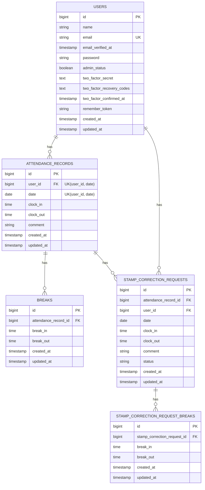

# 勤怠管理アプリ

## 作成者

小谷　知代

## 開発環境URL

http://localhost/

## 環境構築手順

1. **リポジトリをクローン**

   ```bash
   git clone https://github.com/stenonycho2525/attendance-app.git
   ```

2. **.envファイルの準備**

   .env.example をコピーして .env を作成
   ```bash
   cd attendance-app
   cp .env.example .env
   ```

3. **Composer依存パッケージのインストール**

   dockerにComposer依存パッケージをインストール
   ```bash
   docker run --rm \
    -u "$(id -u):$(id -g)" \
    -v "$(pwd):/var/www/html" \
    -w /var/www/html \
    -e COMPOSER_CACHE_DIR=/tmp/composer_cache \
    laravelsail/php82-composer:latest \
    composer install
   ```

4. **Laravel Sailの起動**

   Laravel Sailを起動する
   ```bash
   ./vendor/bin/sail up -d
   ```

5. **アプリケーションキーの生成**

   アプリケーションキーを生成
   ```bash
   ./vendor/bin/sail artisan key:generate
   ```

6. **データベースのマイグレーションを作成**

   マイグレーションを作成
   ```bash
   ./vendor/bin/sail artisan migrate
   ```

7. **フロントエンドのビルド**

   JavaScriptのパッケージをインストールする
   ```bash
   ./vendor/bin/sail npm install
   ```

8. **Vite開発サーバーの起動**

   別のターミナルで下記のコマンドを実行する
   ※このコマンドは常に実行した状態にしておく
   ```bash
   sail npm run dev
   ```

9. **アプリケーションへのアクセス**

   ブラウザで以下のURLを開く
   http://localhost

## 使用技術

- PHP 8.3.6
- Laravel 10.50.2
- MySQL 8.0
- Docker / Laravel Sail
- Tailwind CSS

## ER図


## URL

開発環境：http://localhost/
phpMyAdmin：http://localhost:8080/